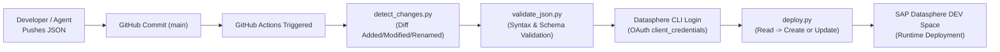

# SAP Datasphere CI/CD Automated Deployment via GitHub Actions

This repository implements a production-grade CI/CD pipeline for **SAP Datasphere**. It monitors Core Data Services (CSN) JSON artifacts committed to GitHub, detects changes, validates schemas, authenticates non-interactively using OAuth 2.0 Client Credentials, and deploys/updates models directly in an SAP Datasphere DEV Space using `@sap/datasphere-cli`.

---

## 1. Architecture Overview



### Deployment Flow:
1. **Change Detection**: Analyzes git diff against previous commit (`HEAD~1` or `github.event.before`) to isolate only modified, newly added, or renamed JSON files under `artifacts/`.
2. **Schema & Syntax Validation**: Validates JSON syntax, technical naming conventions, and CSN definition integrity before touching the remote tenant.
3. **Headless Authentication**: Uses SAP Datasphere CLI (`@sap/datasphere-cli`) with OAuth 2.0 `client_credentials` flow and `-F` (force non-interactive mode).
4. **Dependency-Aware Deployment**:
   - Deploys in dependency order: `local-tables` ➔ `remote-tables` ➔ `views` ➔ `analytic-models`.
   - Checks if object exists in the target space via `datasphere objects <type> read`.
   - Executes `create` if new, or `update` if already existing.
   - Deploys into runtime automatically.

---

## 2. Repository Structure

```
datasphere-cicd/
├── .github/
│   └── workflows/
│       └── deploy-datasphere.yml    # CI/CD Workflow configuration
├── artifacts/
│   ├── views/                       # SQL and Graphical View CSN JSON definitions
│   │   └── ZDEMO_SALES_VIEW.json   # Sample SQL View
│   ├── local-tables/                # Local table JSON definitions
│   ├── remote-tables/               # Remote table JSON definitions
│   └── analytic-models/             # Analytic model JSON definitions
├── scripts/
│   ├── detect_changes.py            # Git diff parser for JSON artifacts
│   ├── validate_json.py             # Pre-flight syntax and schema validator
│   └── deploy.py                    # Datasphere CLI deployment orchestrator
├── config/
│   └── deployment.json              # Artifact mapping, priority & settings
├── package.json                     # Pinned @sap/datasphere-cli dependency
├── .gitignore
└── README.md
```

---

## 3. SAP Datasphere OAuth Setup (Prerequisites)

To enable headless authentication without browser prompts in GitHub Actions, create an OAuth 2.0 client in SAP Datasphere:

1. Log in to SAP Datasphere as a **System Administrator** / **DW Administrator**.
2. Navigate to **System** ➔ **Administration** ➔ **App Integration**.
3. Under **OAuth Clients**, click **Add a New OAuth Client**.
4. Configure:
   - **Name**: `GitHub_Actions_CICD`
   - **Purpose**: `Interactive Usage` (or API Access)
   - **Redirect URI**: `http://localhost:8080`
5. Note the generated credentials:
   - **Client ID** (`DSP_CLIENT_ID`)
   - **Client Secret** (`DSP_CLIENT_SECRET`)
   - **Token URL** (`DSP_TOKEN_URL`)
   - **Datasphere Host / Tenant URL** (`DSP_HOST`), e.g., `https://my-tenant.eu10.hcs.cloud.sap`

---

## 4. GitHub Repository Secrets Required

Configure the following secrets under **Repository Settings** ➔ **Secrets and variables** ➔ **Actions**:

| Secret Name | Description | Example |
|---|---|---|
| `DSP_HOST` | SAP Datasphere Tenant URL | `https://mytenant.eu10.hcs.cloud.sap` |
| `DSP_CLIENT_ID` | OAuth Client ID | `sb-0d85e619-xxxx-xxxx-xxxx-xxxxxxxxxxxx!b123` |
| `DSP_CLIENT_SECRET` | OAuth Client Secret | `1dcc0522-xxxx-xxxx-xxxx-xxxxxxxxxxxx=` |
| `DSP_TOKEN_URL` | OAuth 2.0 Token Endpoint URL | `https://mytenant.authentication.eu10.hana.ondemand.com/oauth/token` |
| `DSP_SPACE_ID` | Target Datasphere DEV Space ID | `DEV_SPACE` |

---

## 5. Technical Investigation & Solutions

| Deployment Consideration | Findings & Implementation |
|---|---|
| **1. Non-interactive Runner Authentication** | The CLI supports headless authentication via `datasphere login --host "$DSP_HOST" --authorization-flow client_credentials --token-url "$DSP_TOKEN_URL" --client-id "$DSP_CLIENT_ID" --client-secret "$DSP_CLIENT_SECRET" -F`. The `-F` (`--force`) flag suppresses prompts when overwriting cache. |
| **2. Client Credentials Grant Type** | Fully supported in `@sap/datasphere-cli`. Verified directly in `@sap/cli-core` (`getToken.js`). Does not require browser interaction or passcode retrieval. |
| **3. Space Selection** | The `--space <space_id>` flag is passed to all object-level commands (`read`, `create`, `update`). |
| **4. Existing Object Verification** | `deploy.py` performs a pre-flight probe using `datasphere objects <type> read --space <space> --technical-name <name>`. If exit code is 0, the object exists. |
| **5. Create vs Update** | The deployment probe uses the technical name to detect existing objects. Create and update commands pass the JSON file with `--file-path`; the technical name is read from the JSON definition, matching the supported CLI usage. |
| **6. Automatic Deployment** | In `@sap/datasphere-cli`, `create` and `update` deploy the object automatically into the runtime database unless `--no-deploy` is specified. |
| **7. Dependency Ordering** | Artifacts are prioritized by `config/deployment.json`: tables (priority 1-2) ➔ views (priority 3) ➔ analytic models (priority 4). |
| **8. Error Capturing** | CLI stdout/stderr are captured line-by-line; on any non-zero exit code, deployment immediately halts to prevent dependent failures. |
| **9. Duplicate Prevention** | Handled by reading object status before deciding whether to call `create` or `update`. |
| **10. Renamed / Deleted Files** | Handled in `detect_changes.py`: git renames detect the new path; deletions are safely logged and excluded from automatic deletion per POC scope. |

---

## 6. Local Testing & Verification

You can test all scripts locally before triggering GitHub Actions:

```bash
# 1. Detect all artifacts or changes
python scripts/detect_changes.py --all --output changed_artifacts.json

# 2. Validate JSON syntax and structure
python scripts/validate_json.py --input changed_artifacts.json --config config/deployment.json

# 3. Simulate deployment in Dry-Run mode
python scripts/deploy.py --input changed_artifacts.json --space DEV --dry-run
```
